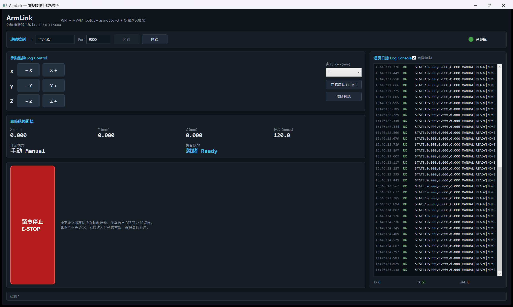

# ArmLink

**一套用來展示「上位機軟體（SCADA / HMI）開發能力」的開源專案：虛擬機械手臂控制台 + 軟體測試框架。**

[](https://github.com/shuaib666-666/ArmLink/actions/workflows/ci.yml)
[](LICENSE)



專案用 **WPF (.NET 8) + MVVM + async Socket** 實作一套完整的機械手臂上位機：從通訊協定、封包編解碼、自動重連，到內建的虛擬機台模擬器（Mock Server）與 xUnit 單元／整合測試，全部在同一個 Solution 裡，可一鍵執行、一鍵測試。

> 不用買機台、不用接實體線路，Clone 下來 `dotnet run`：模擬器自動啟動並連線，座標即時跳動、通訊日誌持續串流。

---

## 專案特色

| 類別 | 實作內容 |
| --- | --- |
| 通訊 | TCP/IP Socket 全程 `async/await`，支援 `CancellationToken`；以 `\n` 結框的文字協定（`MOVE:X,Y,Z` / `STATE:...`） |
| 穩健性 | **自動重連**（指數退避 + Jitter）、連線逾時、指令 ACK 逾時、連線中斷事件；任何例外都不會讓程式崩潰 |
| 資料驗證 | 協定解析全面採 **Try Pattern**（壞封包只會回傳 `false`，不拋例外）；長度上限、控制字元、NaN / Infinity 一律擋下 |
| 安全機制的軟體實作 | 行程邊界檢查（Software Limit）、自動模式下禁用 Jog、急停後必須 RESET 才能復歸 |
| 模擬器 | 內建 `MockRobotServer`：支援多客戶端、模擬機台處理延遲、**每 100ms 廣播座標**、可注入故障（壞封包 / ACK 失敗率） |
| 介面 | MVVM（CommunityToolkit.Mvvm），`MainWindow.xaml.cs` 只有兩行；跨執行緒 UI 更新統一走 `IUiDispatcher` |
| 測試 | 75 個 xUnit 測試，涵蓋正常／損壞封包解析、軟體極限、狀態機、逾時、真實 Socket 重連 |

---

## 系統架構

```
┌─────────────────────────────────────────────────────────────┐
│  ArmLink.UI  (WPF / net8.0-windows)                     │
│  MainWindow.xaml │ MainViewModel │ IUiDispatcher │ Behavior │
│  ── 只認 ViewModel，不認識 Socket                            │
└───────────────────────────┬─────────────────────────────────┘
                            │ IRobotClient / IRobotServer（介面）
┌───────────────────────────┴─────────────────────────────────┐
│  ArmLink.Core  (Class Library / net8.0)                 │
│                                                             │
│  Protocol    RobotProtocol / RobotCommand / RobotResponse   │
│  Models      RobotPose / RobotLimits / RobotStatusSnapshot  │
│  Communication  TcpRobotClient ▸ Channel 佇列 + 讀寫緒 + 重連│
│  Simulation     VirtualRobotMachine（狀態機）+ MockRobotServer│
│  ── 完全不知道 UI 的存在，可被 Console / 測試直接引用         │
└───────────────────────────┬─────────────────────────────────┘
                            │
┌───────────────────────────┴─────────────────────────────────┐
│  ArmLink.Tests  (xUnit)                                 │
│  協定編解碼 │ 軟體極限 │ 狀態機 │ Socket 整合／逾時／重連     │
└─────────────────────────────────────────────────────────────┘
```

**為什麼這樣切？**
Core 專案不參考任何 UI 組件，因此可以同時被 WPF 上位機、Console 批次工具、CI 裡的自動化測試引用。UI 只透過 `IRobotClient` 介面操作機台，未來要接真實手臂時，只需換掉 App.xaml.cs 裡的客戶端工廠。

---

## 通訊協定

純文字、單行、ASCII，以 `\n` 結框。協定定義集中在 `RobotProtocol`，所有解析都是 Try Pattern。

### 客戶端 → 機台

| 封包 | 說明 | 範例 |
| --- | --- | --- |
| `MOVE:X,Y,Z` | 移動到絕對座標（mm） | `MOVE:120.500,-30.000,50.000` |
| `JOG:dX,dY,dZ` | 相對點動 | `JOG:10.000,0.000,0.000` |
| `HOME` | 回歸原點 | `HOME` |
| `ESTOP` | 緊急停止 | `ESTOP` |
| `RESET` | 錯誤復歸 | `RESET` |
| `SPEED:mm/s` | 設定移動速度 | `SPEED:120.000` |
| `MODE:AUTO｜MANUAL` | 切換作業模式 | `MODE:AUTO` |
| `PING` | 心跳測試 | `PING` |

### 機台 → 客戶端

| 封包 | 說明 | 範例 |
| --- | --- | --- |
| `STATE:X,Y,Z｜MODE｜STATE｜ERR｜SPEED｜SEQ` | 週期性（10Hz）狀態廣播 | `STATE:12.500,0.000,5.000｜MANUAL｜MOVING｜NONE｜120.000｜1042` |
| `OK:CMD｜message` | 指令接受 | `OK:MOVE｜accepted` |
| `ERR:CMD｜CODE｜message` | 指令拒絕 | `ERR:MOVE｜COORDINATE_OUT_OF_RANGE｜X axis...` |

### 穩健性設計

- **永不拋例外的解析器**：`TryParseCommand / TryParseStatus / TryParseResponse` 一律回傳 `(bool, out result, out reason)`
- **上限 + 白名單**：單行 1024 字元上限、拒絕任何控制字元、`double` 排除 NaN / Infinity
- **壞封包事件化**：收到髒資料時觸發 `MalformedPacketReceived` 事件（寫進日誌 + 計數），而不是讓 App 崩潰
- **例外分層**：`RobotException` → `RobotCommunicationException` / `RobotProtocolException` / `RobotTimeoutException` / `CommandRejectedException`，UI 只要 catch 一個家族

---

## 快速開始

### 需求

- Windows（WPF 只能在 Windows 上執行；Core / Tests 是跨平台的 net8.0）
- .NET SDK 8.0 以上

### 建置與執行

```bash
git clone <your-repo-url>
cd ArmLink

# 1) 還原套件
dotnet restore

# 2) 建置整個 Solution
dotnet build

# 3) 跑全部測試（75 個）
dotnet test

# 4) 啟動控制台（內建模擬器會自動起在 127.0.0.1:9000 並自動連線）
dotnet run --project src/ArmLink.UI
```

開啟後會看到四大區塊：

1. **連線控制區**：IP / Port、連線 / 斷線、狀態指示燈（**綠=待命、黃=移動中/連線中、紅=斷線或錯誤**）
2. **手動點動區**：X / Y / Z 軸 ± 按鈕、步長選擇（1 / 10 / 50 mm）、HOME 鍵、紅色**緊急停止**大按鈕
3. **即時狀態監控**：X / Y / Z 座標即時跳動、速度、作業模式、機台狀態
4. **通訊日誌主控台**：TX / RX / SYS / BAD / ERR 分類上色，支援自動捲動與清除，並統計 TX / RX / 壞封包數量

### 模擬器也可以單獨使用（不需要 UI）

也可以在自己的 Console 程式、批次工具或 CI 測試裡直接使用：

```csharp
await using var server = new MockRobotServer(9000);
await server.StartAsync();

await using var client = new TcpRobotClient("127.0.0.1", 9000);
await client.ConnectAsync();

client.StatusReceived += (_, e) => Console.WriteLine(e.Status.Pose);
await client.ExecuteAsync(RobotCommand.Move(new RobotPose(100, 0, 0)));
```

想驗證客戶端在「髒線路」下是否撐得住，調整一下設定即可：

```csharp
var server = new MockRobotServer(new MockRobotServerOptions
{
    Port = 0,                       // 0 = 由系統分配埠號，很適合寫測試
    MalformedPacketRate = 0.3,      // 30% 的機率故意丟出一條畸形封包
    AckFailureRate = 0.1,           // 10% 的機率直接回 ERR
    CommandProcessDelay = TimeSpan.FromMilliseconds(60),
});
```

---

## 測試策略

```bash
dotnet test
# 已通过! - 失败: 0，通过: 75
```

| 測試類別 | 檔案 | 涵蓋重點 |
| --- | --- | --- |
| 協定編解碼 | `RobotProtocolTests.cs` | 正常封包還原（含大小寫、換行符容錯）、12 種損壞指令、8 種損壞狀態封包、4 種損壞回應、超長封包、UNKNOWN token |
| 軟體極限 | `RobotLimitsTests.cs` | 邊界含上限、越界回報哪一軸、NaN / Infinity、反向區間 |
| 狀態機 | `VirtualRobotMachineTests.cs` | 插值運動、 Jog 相對位移、重設覆蓋、自動模式禁用 Jog、急停凍結 + RESET 復歸、速度範圍、封包序號遞增 |
| 客戶端整合 | `TcpRobotClientTests.cs` | 真實 Socket 連線、狀態廣播、ACK 逾時（`RobotTimeoutException`）、指令被拒（`CommandRejectedException`）、壞封包事件、**機台重啟後自動重連**、退避策略 |

---

## 專案結構

```
ArmLink/
├── Directory.Build.props           # LangVersion / Nullable / 分析器統一設定
├── ArmLink.sln
├── src/
│   ├── ArmLink.Core/
│   │   ├── Abstractions/           # IRobotClient / IRobotServer / 事件參數
│   │   ├── Communication/          # TcpRobotClient / ReconnectPolicy / Options
│   │   ├── Exceptions/             # RobotException 家族
│   │   ├── Models/                 # RobotPose / RobotLimits / MachineState ...
│   │   ├── Protocol/               # RobotProtocol / RobotCommand / RobotResponse
│   │   └── Simulation/             # VirtualRobotMachine / MockRobotServer
│   └── ArmLink.UI/
│       ├── App.xaml(.cs)           # Composition Root：組裝一切
│       ├── Behaviors/              # AutoScrollBehavior（讓 Code-behind 保持乾淨）
│       ├── Services/               # IUiDispatcher / WpfDispatcher
│       ├── ViewModels/             # MainViewModel / LogLine
│       └── Views/MainWindow.xaml
└── tests/ArmLink.Tests/
    ├── Models/RobotLimitsTests.cs
    ├── Protocol/RobotProtocolTests.cs
    ├── Simulation/VirtualRobotMachineTests.cs
    └── Communication/TcpRobotClientTests.cs
```

---

## 幾個值得在面試時拿出來講的設計

1. **為什麼解析器不用例外？**
   工控現場的線路一定會有雜訊。「每收到一筆髒資料就丟例外」會讓 UI 緒列充滿 try/catch，甚至拖垮效能。改成 Try Pattern 後，髒資料只是 `false` + 一行日誌，成本趨近於零。

2. **為什麼用 `Channel<T>` 當送出佇列？**
   使用者狂按 Jog 時，送出端不能被 Socket 的寫入速度卡住。`Channel` 讓「按下按鈕」這件事永遠是 O(1) 排隊，實際 IO 交給單一的背景寫入緒，既保證先進先出，也保證 UI 零卡頓。

3. **為什麼重連要有 Jitter？**
   多台機台同時掉線又同時重連，會在機台恢復的瞬間造成連線風暴（Thundering Herd）。加入 0.8~1.2 倍隨機抖動可以把請求打散。

4. **為什麼 UI 更新要走 `IUiDispatcher`？**
   `StatusReceived` 是在 Socket 讀取緒列上觸發的，直接改 `ObservableCollection` 會讓 WPF 拋出「不支援跨緒列變更」例外。抽象成介面之後，ViewModel 完全可被單元測試替換緒列。

5. **急停為什麼不等 ACK？**
   安全指令的第一優先是延遲，不是完整性。`SendCommandAsync` 直接排進佇列就返回；一般移動指令才用 `ExecuteAsync` 等 ACK，讓使用者知道有沒有被軟體極限擋下。

---

## Roadmap

- [ ] 加入 Serial Port（COM）傳輸層，證明傳輸層可抽換
- [ ] 持久化 Log（寫入 Rolling File + Serilog）
- [ ] 軌跡錄製與回放（G-Code 風格）
- [ ] 3D 檢視（Helix Toolkit）即時顯示手臂姿態
- [x] CI（GitHub Actions）自動建置 + 測試

---

## 授權

MIT License。
